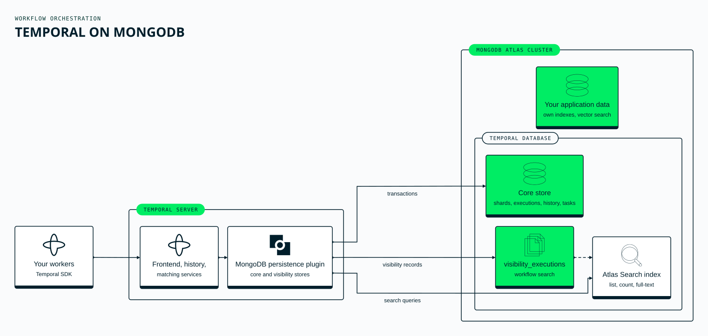

# MongoDB persistence plugin for Temporal

Run a [Temporal](https://temporal.io/) cluster entirely on MongoDB: one
cluster holds Temporal's state **and** answers its visibility queries.
You don't need Cassandra, PostgreSQL or Elasticsearch.

> **Note:** this repository is a **reference implementation** for
> learning and experimentation. **It is not production-ready** in its
> current form.
>
> It shows an architecture and patterns for running Temporal's
> persistence and visibility on MongoDB, but the implementation may
> lack:
>
> - test coverage of every failure mode and deployment shape;
> - hardened error handling and input validation;
> - security hardening and access controls for your environment;
> - performance tuning for large scale;
> - long-term support or upgrade guarantees.
>
> Use it as a starting point for your own implementation, and validate,
> test and adapt it thoroughly before you run it anywhere that matters.
> It is not an officially supported MongoDB product.
>
> **The quickstarts run Temporal without authentication.** They keep it
> on localhost or behind an SSH tunnel. Before anyone else can reach
> Temporal, turn on mTLS and an authorizer
> ([security guide](docs/operator/security.md#secure-the-temporal-frontend-first)),
> and keep personal data out of search attributes
> ([what is stored in plaintext](docs/operator/security.md#what-is-stored-in-plaintext)).

## What it is

An out-of-tree Go module that plugs into an unmodified Temporal server
through Temporal's extension points:

- **Persistence** (`AbstractDataStoreFactory`) for shards, executions,
  history, task queues, namespaces, cluster metadata, Nexus endpoints
  and queues.
- **Visibility** (`VisibilityStoreFactory`), in one of two modes:
  - `atlas-search`: Temporal's list, count and search queries are
    served by Atlas Search, including full-text matching on Text
    search attributes. Runs on Atlas, and on MongoDB 8.2 with search
    (for example `mongodb/mongodb-atlas-local`).
  - `aggregation`: the same queries as aggregation pipelines, on any
    replica set.



Design choices worth knowing (the decision records are in
[`docs/architecture`](docs/architecture)):
- Workflow state stays as opaque blobs.
- Single-document compare-and-set handles shard ownership and record
  versions.
- Multi-document transactions are used only where Temporal needs
  several writes to commit together.
- Every query leads with the shard key, so the schema shards cleanly.

## Compatibility

| | Tested |
|---|---|
| Temporal server | 1.31 and 1.32 (latest patches) |
| MongoDB | 6.0, 7.0, 8.0, 8.2, 8.3 and 9.0 replica sets |
| Atlas | M10 and larger; load-tested on M30 (MongoDB 8.0) and M40 (8.0 and 9.0), including an in-place upgrade from 8.0 to 9.0 under load ([results](docs/operator/sizing.md#what-was-measured)) |
| Visibility `atlas-search` | Atlas M10+, MongoDB 8.2 and 8.3 with search (`mongodb-atlas-local`) |
| Go | 1.26 |

The upstream Temporal persistence test suites run against every store.

Self-hosting on Linux kernel 6.19 or newer (for example Ubuntu 26.04)?
Some MongoDB 8.0 and 8.3 releases refuse to start there; see
[the kernel note](docs/operator/deployment.md#self-hosted-mongodb-on-linux-kernel-619-or-newer).

## Try it

| | |
|---|---|
| [**Docker quickstart**](quickstart/docker) | `./quickstart.sh up` starts MongoDB 8.2 with full-text and vector search, Temporal with this plugin, the Temporal UI and the showcase with its browser UI, all on your machine |
| [**AWS quickstart**](quickstart/aws) | an Atlas M10 cluster peered with an EC2 host that runs Temporal, the showcase and both UIs |
| [**Showcase**](examples/showcase) | a support desk in the browser: durable ticket workflows with signals, updates, timers and schedules; operator queries through Atlas Search–backed visibility; full-text, vector and hybrid search side by side on the same cluster |

```bash
cd quickstart/docker
./quickstart.sh up      # about two minutes; then open http://localhost:8090
./quickstart.sh tour    # a narrated walkthrough that checks every feature
```

## Use it in your own server

**1. Create the schema** (and, for `atlas-search` visibility, the search
index):

```bash
temporal-mongodb-tool setup-schema --uri "$MONGO_URI" --database temporal --num-history-shards 512
temporal-mongodb-tool setup-atlas-search --uri "$MONGO_URI" --database temporal
```

**2. Wire the plugin into your Temporal server binary**
([`cmd/temporal-mongodb-server`](cmd/temporal-mongodb-server) is a
complete example):

```go
import (
    temporalsrv "go.temporal.io/server/temporal"
    plugin "github.com/mohammaddaoudfarooqi/mongodb-temporal-plugin/pkg/plugin"
)

s, err := temporalsrv.NewServer(
    temporalsrv.WithConfig(cfg),
    temporalsrv.WithCustomDataStoreFactory(plugin.NewFactory()),
    temporalsrv.WithCustomVisibilityStoreFactory(plugin.NewVisibilityFactory()),
)
```

**3. Point Temporal's configuration at MongoDB:**

```yaml
persistence:
  defaultStore: mongo-default
  visibilityStore: mongo-visibility
  numHistoryShards: 512
  datastores:
    mongo-default:
      customDatastore:
        name: mongodb
        options:
          uri: mongodb+srv://cluster.example.mongodb.net/
          username: temporal_runtime
          passwordEnv: MONGO_TEMPORAL_PW
          database: temporal
          numHistoryShards: 512
    mongo-visibility:
      customDatastore:
        name: mongodb
        options:
          uri: mongodb+srv://cluster.example.mongodb.net/
          username: temporal_runtime
          passwordEnv: MONGO_TEMPORAL_PW
          database: temporal
          visibilityMode: atlas-search
```

Both stores use one database. Atlas Search indexes the visibility
collection in place, so there is no separate search system to run or
keep in sync. (Separate databases are
[an option](docs/operator/deployment.md#optional-separate-databases) if
you want database-level permissions.)

Every option is in
[`docs/operator/config-reference.md`](docs/operator/config-reference.md).

## Documentation

| | |
|---|---|
| [`docs/operator`](docs/operator) | deployment, configuration, sizing, sharding, retention, security, runbook, Kubernetes |
| [`docs/architecture`](docs/architecture) | architecture decision records |
| [`docs/developer`](docs/developer) | conventions, testing, versioning, release, supply chain |
| [`deploy/aws-qualify`](deploy/aws-qualify) | release qualification on real AWS and Atlas infrastructure: functional, failover, node loss, load ladder and soak, with a GO/NO-GO report |

## Development

```bash
make vet unit                # vet and unit tests (no external services)
make integration             # integration tests: Docker starts MongoDB replica sets
make conformance             # Temporal's upstream persistence suites (~30 min)
make lint                    # guard scripts for known regressions
make build                   # bin/temporal-mongodb-server and bin/temporal-mongodb-tool
make examples                # the example modules (e2e scenarios, showcase)
make ui                      # the showcase's browser UI (Node.js 20.19+ or 22.12+)
make qualify-lint qualify-test   # the release-qualification harness, offline
```

See [`CONTRIBUTING.md`](CONTRIBUTING.md). Every commit needs a DCO
`Signed-off-by` line.

## Repository layout

```
pkg/plugin/            the public API: NewFactory, NewVisibilityFactory
internal/              store implementations, visibility, the MongoDB driver facade
cmd/
  temporal-mongodb-server/   a Temporal server binary with the plugin wired in
  temporal-mongodb-tool/     schema setup, upgrade, verify, Atlas Search index
schema/                versioned collection and index manifests, Atlas Search definitions
quickstart/            Docker and AWS quickstarts
examples/
  showcase/            the support-desk showcase: workflows, CLI and browser UI
  e2e/                 end-to-end scenarios and a load runner
deploy/                Docker Compose stack and the AWS release-qualification harness
docs/                  operator, architecture and developer documentation
```

## Security

Please report vulnerabilities privately; see [`SECURITY.md`](SECURITY.md).

## License

Apache 2.0. See [`LICENSE`](LICENSE) and [`NOTICE`](NOTICE).
