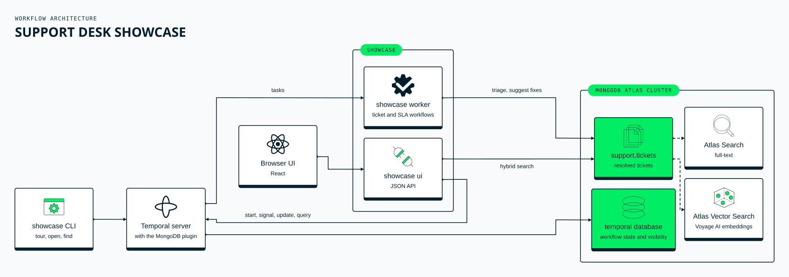
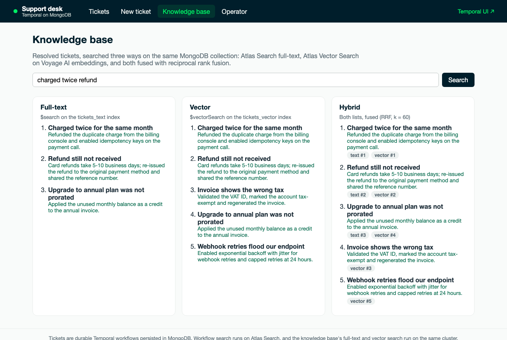
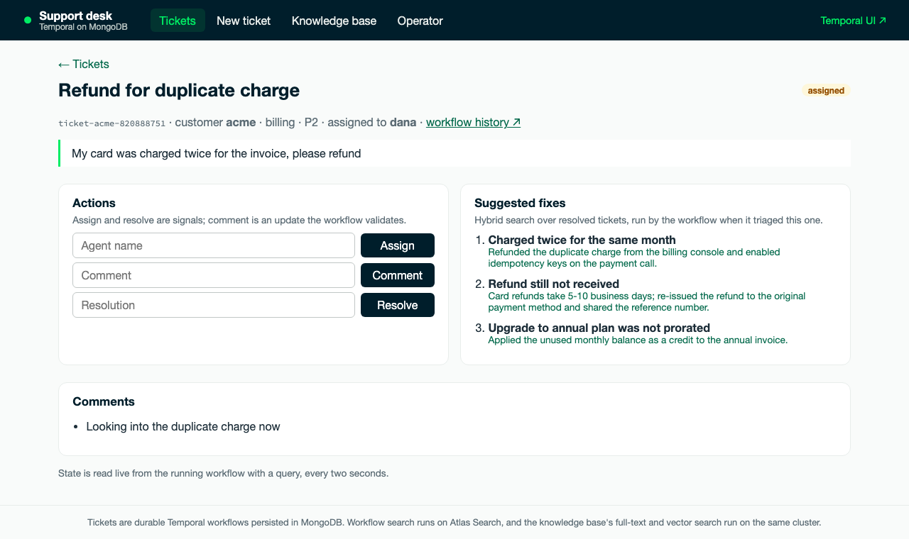

# Showcase: a support desk on Temporal and MongoDB

A small, complete application that shows what running Temporal on
MongoDB gives you. **One cluster** does three jobs:

1. **Temporal's persistence.** Every ticket is a durable
   `TicketWorkflow`, with its history, timers and state stored in
   MongoDB through the plugin.
2. **Temporal visibility.** Operators find workflows with queries the
   plugin answers from MongoDB. In `atlas-search` mode this uses
   Atlas Search, including full-text matching on Text search attributes.
3. **Application data and search.** The tickets live in the same
   cluster, with a full-text (`$search`) and a vector (`$vectorSearch`)
   index. A new ticket gets suggested fixes from resolved ones through
   hybrid search.

It comes with a browser UI and a CLI.





## The browser UI

`showcase ui` serves a React app and a small JSON API from the same
binary:

| Screen | What it shows |
|---|---|
| **Tickets** | Every ticket workflow, listed by a Temporal visibility query that the plugin answers from Atlas Search. Each ticket's live state is read from the running workflow with a query; assign and resolve are signals, and comment is a validated update. |
| **New ticket** | Opens a ticket, which starts a workflow that triages it, finds suggested fixes and escalates it if its SLA timer fires. |
| **Knowledge base** | One query, three ways: Atlas Search full-text, Atlas Vector Search, and both fused with reciprocal rank fusion. |
| **Operator** | Visibility queries over every workflow in the namespace (keyword, range, full-text on a Text attribute, system attributes) and the SLA report. |



The UI has no authentication. It listens on `127.0.0.1:8090` unless
`SHOWCASE_UI_ADDR` says otherwise; the quickstarts keep it on localhost
or behind the SSH tunnel. It refuses requests from other sites: the
`Host` header must be `localhost` or a loopback address (list other
names in `SHOWCASE_UI_HOSTS`, comma-separated), API calls must come from
the UI's own origin, and changes must be sent as JSON.
`TEMPORAL_UI_URL` (default `http://localhost:8080`) sets where the
workflow links point.

## What it demonstrates

| Feature | Where |
|---|---|
| Durable workflow per business entity | [`app/workflows.go`](app/workflows.go) `TicketWorkflow` |
| Activities with retries; a failing search doesn't block the ticket | `Triage`, `StoreTicket`, `FindSimilar`, `Resolve` |
| Signals: `assign`, `resolve` | human-in-the-loop steps |
| Validated update: `comment` | rejects empty comments and comments on resolved tickets before they reach history |
| Query: `ticket` | the live ticket state and its suggestions |
| Durable timer | SLA per priority; if nobody responds in time, the ticket escalates |
| Search attributes | `CustomerId`, `Category`, `TicketStatus` (Keyword), `Priority` (Int), `Summary` (**Text**, full-text) |
| Visibility queries | `Category = 'billing'`, `Priority >= 3`, `Summary = 'unavailable'`, `ORDER BY StartTime DESC`, `COUNT … GROUP BY ExecutionStatus` |
| Schedule | `sla-report` runs `SLAReportWorkflow` every 5 minutes, built from visibility counts |
| Hybrid search | [`kb/store.go`](kb/store.go): `$search` + `$vectorSearch`, fused with Reciprocal Rank Fusion ([`kb/fuse.go`](kb/fuse.go)) |
| A learning loop | a resolved ticket's fix is written back and suggested for later, similar tickets |

## Embeddings

`SHOWCASE_EMBEDDING` chooses how vector search gets its embeddings:

| Mode | When | How |
|---|---|---|
| `auto` | Atlas (M10+, storage auto-scaling) | **Atlas automated embedding**: the vector index has an `autoEmbed` field with a Voyage AI model; the app stores text and queries with text. Preview feature. |
| `voyage` | Any MongoDB 8 with search (e.g. the Docker quickstart) | The app calls MongoDB's Embedding API (`ai.mongodb.com`) with an Atlas model API key (`VOYAGE_API_KEY`) and stores vectors. `VOYAGE_URL` overrides the endpoint, e.g. `https://api.voyageai.com/v1/embeddings` for a key created on voyageai.com. |
| `none` | No key | Full-text search only |

Without `SHOWCASE_EMBEDDING`, the mode is `voyage` when `VOYAGE_API_KEY`
is set, and `none` otherwise.

**`auto` and `voyage` send ticket text to Voyage AI models** hosted by
MongoDB: from the cluster in `auto` mode, from the app in `voyage` mode. The showcase
is for demo data; use `none` if no text may leave your deployment.

## Run it

The quickest way is a [quickstart](../../quickstart), which starts
MongoDB, Temporal, the Temporal UI and this showcase with its browser UI:

```bash
cd quickstart/docker && ./quickstart.sh up && ./quickstart.sh tour
```

Then open the support desk at <http://localhost:8090>.

Against your own Temporal server (with the MongoDB plugin) and MongoDB:

```bash
export TEMPORAL_ADDRESS=localhost:7233 MONGODB_URI='mongodb://localhost:27017/?directConnection=true'
go run ./cmd/showcase setup     # namespace, search attributes, indexes, seed tickets, schedule
go run ./cmd/showcase worker &  # the workflows and activities
go run ./cmd/showcase tour      # every feature, each one checked
go run ./cmd/showcase ui        # the browser UI on http://localhost:8090
```

`showcase ui` embeds the UI from `web/dist`. Build it first with
`make ui` from the repository root (Node.js 20.19+ or 22.12+), or
`npm ci && npm run build` in `ui/`; without a build, the server answers
with a page that says how. For UI development, run `showcase ui` and
`npm run dev` in `ui/`, which proxies the API.

Other commands: `open`, `assign`, `comment`, `resolve`, `show`, `find`,
`search` and `report`. Run `go run ./cmd/showcase` for usage.

## Tests

```bash
go test ./...                       # unit: workflows (SDK test env), desk, web API, fusion, index definitions, Voyage client
(cd ui && npm test)                 # UI helpers (routes, links, statuses)
go test -tags=integration ./kb/     # real $search and $vectorSearch on MongoDB 8.2 (Docker)
```

`showcase tour` is the end-to-end test: it exits non-zero if any feature
does not behave as described.
