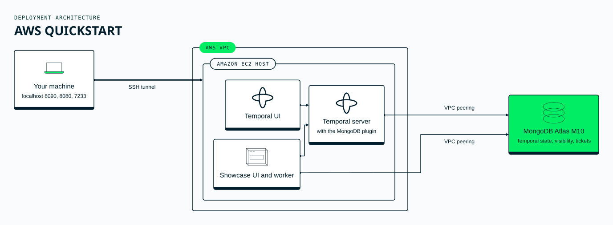

# Quickstart: Temporal on MongoDB Atlas, on AWS

`quickstart.sh up` creates a working deployment in us-east-1:

- an **Atlas M10 cluster** in your Atlas project, with storage
  auto-scaling;
- a **VPC peered with Atlas**, so the database is reached privately; the
  Atlas access list admits only that VPC;
- one **EC2 host** (c6i.large, Amazon Linux 2023) running, as systemd
  services:
  - the Temporal server with the MongoDB plugin (visibility on Atlas
    Search);
  - the showcase worker and its browser UI (a support desk; see
    [`examples/showcase`](../../examples/showcase));
  - the Temporal Web UI.

Nothing is exposed to the internet except SSH from the addresses you
allow. The UIs and gRPC are reached through an SSH tunnel.

> **Temporal runs without authentication.** Anyone with the tunnel, or
> with a shell on the host, can use every workflow. Keep SSH access
> limited to you. Before giving anyone else access, turn on mTLS and an
> authorizer
> ([security guide](../../docs/operator/security.md#secure-the-temporal-frontend-first)).



## What you need

- **Tools:** `terraform` 1.13 or later, the `aws` CLI, `jq`, `go` 1.26,
  Node.js 20.19+ or 22.12+ with `npm` (to build the support desk's UI), `git`,
  `python3`, `ssh`/`scp` and `curl`.
- **An Atlas project**, and a **project-level API key with Project Owner**
  on it. The quickstart creates and deletes only the cluster, network
  peering, access list entry, database user and (if missing) the
  project's AWS network container. It never creates or deletes projects.
- **AWS credentials** that can create and delete a VPC, subnet, internet
  gateway, route table and routes, a security group, a key pair, an EC2
  instance and a VPC peering accepter. No IAM, SSM or S3 permissions
  are needed. Short-lived credentials are fine: they're used only while
  `up` creates resources and `down` deletes them.

## Deploy

```bash
cd quickstart/aws
cp .env.example .env        # fill in the Atlas key, project ID, AWS credentials
./quickstart.sh up          # about 15 minutes, mostly the Atlas cluster build
./quickstart.sh tunnel      # leave running; open http://localhost:8090 (support desk)
                            # and http://localhost:8080/namespaces/support/workflows (Temporal UI)
./quickstart.sh tour        # in another terminal
```

With the tunnel open, `localhost:7233` reaches Temporal, so the
`temporal` CLI and your own workers work as if the server were local.

## Vector search

The showcase's semantic search uses Voyage AI embeddings:

| `.env` | How embeddings are made |
|---|---|
| no `VOYAGE_API_KEY` (default) | **Atlas automated embedding**: Atlas embeds the text with Voyage AI and queries pass plain text. This is a preview feature, billed per token on your Atlas invoice. |
| `VOYAGE_API_KEY=…` | The showcase calls MongoDB's Embedding API (`ai.mongodb.com`) itself, with an Atlas model API key, and stores the vectors. |

Either way, **ticket text is sent to Voyage AI**. The showcase is for
demo data only; don't load real customer tickets into it.

## Cost

About **$0.20 per hour** while it runs: an Atlas M10 (about $0.08/h),
a c6i.large (about $0.085/h), plus storage, data transfer and any
embedding tokens. The host does not stop by itself.

## Tear down

```bash
./quickstart.sh down
```

This destroys everything the quickstart created, then checks that no
AWS resource tagged with the deployment and no Atlas cluster, peering or
access list entry of it remain. It exits non-zero and lists anything
left. If your AWS credentials have expired, refresh them in `.env`
first.

## Security notes

- Two database users are created:
  - an admin user that sets up the schema and indexes once and is never
    stored on the host;
  - a runtime user with `readWrite` on the Temporal and showcase
    databases only, which is all the services hold.
- Temporal and the showcase worker run as a dedicated `temporal` system
  user (no login shell, no sudo).
- `.run/` and `deploy/aws-qualify/terraform/terraform.tfstate.d/` hold
  generated credentials. Keep them private, and don't sync them.
  `down` deletes the database users.

- `.env`, `.run/` and `artifacts/` are gitignored.
  - `.env` is read as plain text, never executed.
  - The Atlas key reaches `curl` only through a 0600 file.
  - The connection string reaches the host only over SSH stdin, into
    0600 files.
- SSH is allowed only from your current public IP, plus any ranges in
  `ADMIN_CIDRS`.
- The Atlas database user can access only this deployment's cluster.

This is a starting point for evaluation, not a hardened production
environment. Review the networking, credentials and backup settings
before relying on it.
